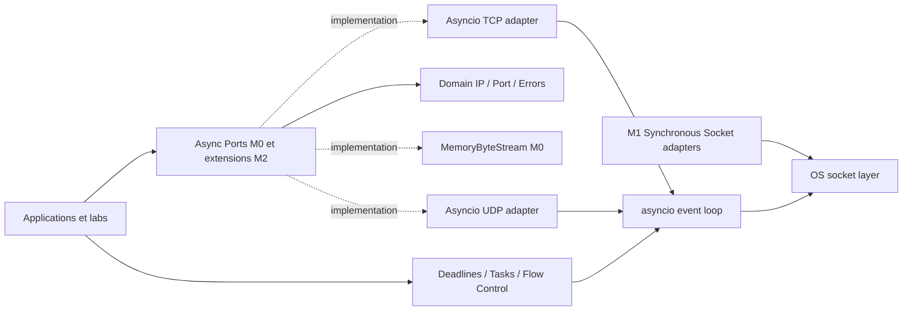

# 29 - PyNetworkKit M2 : Async Core - Plan d'implémentation

> Date : 2026-11-02
> Statut : PLAN APPROUVÉ POUR BOOTSTRAP, M2 NON IMPLÉMENTÉ
> Milestone : M2 - Async Core (v0.2.0a1)
> GitHub Project v2 : https://github.com/users/tawounfouet/projects/9
> Source des identifiants et critères : issues GitHub #73 à #114 créées par le bootstrap M2.
> Édition GitHub synchronisée sur les 42 issues existantes. Les versions documentaires historiques locales restent des archives.
> Version cible de développement : 0.2.0a1 (aucun tag ni package publié).
> Portée : 6 Epics, 36 sous-issues, 9 PR candidates.

## 0. Résumé exécutif

M2 ajoute des adaptateurs réellement asynchrones TCP et UDP fondés sur `asyncio`, la sécurité des annulations, les deadlines monotones et la backpressure, sans régression des contrats M0/M1. La bibliothèque suit Domain-Driven Design (DDD), l'architecture hexagonale, le Dependency Inversion Principle (DIP), l'Interface Segregation Principle (ISP), Design by Contract et TDD. Les exemples et tests doivent rendre visibles les primitives Python utilisées.

M0 fournit déjà `AsyncByteStream`, `AsyncStreamConnector`, `MemoryByteStream` et `create_memory_stream_pair`. M1 fournit `SyncByteStream`, les adaptateurs sockets TCP/UDP et `ReceivedDatagram`. M2 **ne remplace pas ces contrats** : il implémente le réseau non bloquant et les politiques d'exécution associées.

Décision : GO pour l'exécution séquencée du backlog M2. NO-GO pour la publication de 0.2.0a1 ou de 0.1.0a2 au titre de ce plan.

## 1. Sources et autorité des contrats

| Artefact | Autorité |
| --- | --- |
| `src/pynetworkkit/ports/streams.py` | Signatures publiques async M0 à préserver |
| `src/pynetworkkit/adapters/memory/streams.py` | Backpressure mémoire par octets, fermeture et limites |
| `src/pynetworkkit/ports/sync_streams.py` | TCP synchrone M1 distinct |
| `src/pynetworkkit/ports/sync_datagrams.py` | Valeur objet `ReceivedDatagram` |
| `src/pynetworkkit/adapters/socket/` | Semantique de troncature, ownership et erreurs M1 |
| `12_PYNETWORKKIT_ASYNC_NETWORKING_MODEL.md` | Conceptuel, non normatif si différent du code |
| `16_PYNETWORKKIT_IMPLEMENTATION_ROADMAP.md` | Ordre des jalons |
| `28_PYNETWORKKIT_M1_POST_IMPLEMENTATION_REVIEW_AND_M2_HANDOFF_2026-11-02.md` | Handoff M1 |
| GitHub #73-#114 | Critères opérationnels et statuts réels du backlog |

Le modèle illustratif ancien `connect(host,port)` et `close()` n'annule pas les signatures livrées : `connect(endpoint: IPEndpoint)` et `aclose()`. Un changement public exige une ADR acceptée et des tests de compatibilité.

## 2. Architecture hexagonale et dépendances



Invariants :
- `domain` et `ports` n'importent ni `socket` ni `asyncio` ni les adaptateurs.
- Les sockets non bloquantes et tâches asynchrones sont détenues par un propriétaire explicite.
- Un appel synchrone bloquant ne doit jamais s'exécuter dans une coroutine M2.
- Les contrats `asyncio` ne revendiquent pas de limites temporelles sans deadline explicite.
- TCP est un flux ordonné d'octets, pas un système de messages.
- UDP est un système de datagrammes, dont `b""` est une donnée valide.

## 3. Compatibilité M0 et M1

```python
class AsyncByteStream(Protocol):
    async def read(self, max_bytes: int) -> bytes: ...
    async def write(self, data: bytes) -> None: ...
    async def aclose(self) -> None: ...


class AsyncStreamConnector(Protocol):
    async def connect(self, endpoint: IPEndpoint) -> AsyncByteStream: ...
```

Les API sync M1 restent indépendantes. `write()` async accepte tous les octets dans le transport, sans garantir leur livraison au pair; `write()` sync peut renvoyer un nombre partiel. Une annulation pendant un write peut laisser un préfixe accepté. `read(max_bytes)` positif renvoie `b""` uniquement pour EOF TCP, jamais comme marqueur UDP. `aclose()` reste idempotent.

## 4. Objectifs et limites

Objectifs : adaptateurs asyncio TCP connector/listener/stream, canal UDP avec identité du pair et troncature, cancellation-safe resource management, deadlines monotones, backpressure bornée et suites de tests communes. Python >=3.11, CI 9 environnements (Linux/macOS/Windows x 3.11/3.12/3.13).

Hors périmètre : DNS général, TLS/certificats, protocoles HTTP, framing applicatif, scheduler propriétaire, retransmission UDP, résilience distribuée, observabilité multi-services et simulation réseau complète. Aucune connexion Internet nécessaire pour les tests.

## 5. Six Epics GitHub

| Epic | Périmètre | Issue | Sous-issues |
| --- | --- | --- | --- |
| E00 | Async Contracts & M0 Compatibility | [#73](https://github.com/tawounfouet/pynetworkkit/issues/73) | #79 à #84 |
| E01 | Async TCP Streams, Connector & Listener | [#74](https://github.com/tawounfouet/pynetworkkit/issues/74) | #85 à #90 |
| E02 | Async UDP Datagrams | [#75](https://github.com/tawounfouet/pynetworkkit/issues/75) | #91 à #96 |
| E03 | Cancellation, Deadlines & Ownership | [#76](https://github.com/tawounfouet/pynetworkkit/issues/76) | #97 à #102 |
| E04 | Backpressure & Bounded Concurrency | [#77](https://github.com/tawounfouet/pynetworkkit/issues/77) | #103 à #108 |
| E05 | Contracts, Labs, CI & Technical Closure | [#78](https://github.com/tawounfouet/pynetworkkit/issues/78) | #109 à #114 |

Chaque Epic se ferme lorsque ses six enfants sont techniquement terminés avec preuve de tests, ADR applicable, PR revue, SHA exact fusionné et CI post-fusion. La fermeture d'un Epic n'autorise pas une release.

## 6. Architecture décisionnelle et gates E00

Décisions à inscrire en ADR-M2-01..08 avant les changements d'API ou l'implémentation de comportements irréversibles :

| ADR proposée | Décision attendue |
| --- | --- |
| ADR-M2-01 | Ports TCP asyncio et listener, compatibilité M0 |
| ADR-M2-02 | Lifecycle, close, accept/connect et ownership |
| ADR-M2-03 | UDP `ReceivedDatagram`, troncature portable Win/POSIX |
| ADR-M2-04 | Cancellation, garanties et nettoyage après interruption |
| ADR-M2-05 | Deadlines absolues monotones et propagation |
| ADR-M2-06 | Backpressure, watermarks et limites en octets |
| ADR-M2-07 | Concurrence bornée et politique de saturation |
| ADR-M2-08 | Test doubles, contrats, plateformes et qualification |

Les ADR restent PROPOSED tant qu'une revue explicite et sa décision ne sont pas consignées. La preuve CI ne vaut pas adoption d'une ADR.

## 7. Backlog d'implémentation : 36 tâches

Critères source synchronisés depuis les issues M2 GitHub. Priorité et dépendances sont les champs connus; elles ne constituent pas un graphe natif de dépendances GitHub tant qu'il n'est pas configuré.

| ID | Epic | Issue | Priorité | Dépendances | Tâche | Critère d'acceptation |
| --- | --- | --- | --- | --- | --- | --- |
| PNK-M2-001 | E00 | [#79](https://github.com/tawounfouet/pynetworkkit/issues/79) | P0 | M1 | Auditer ports M0/M1, tests, exports et compatibilité | Matrice API avant/après, preuve SHA |
| PNK-M2-002 | E00 | [#80](https://github.com/tawounfouet/pynetworkkit/issues/80) | P0 | 001 | Décider `AsyncStreamListener` et lifecycle public | ADR-M2-01/02 |
| PNK-M2-003 | E00 | [#81](https://github.com/tawounfouet/pynetworkkit/issues/81) | P0 | 001 | Décider `AsyncDatagramChannel`, `ReceivedDatagram`, erreurs | ADR-M2-03 et signatures typées |
| PNK-M2-004 | E00 | [#82](https://github.com/tawounfouet/pynetworkkit/issues/82) | P0 | 001 | Spécifier cancellation, ownership et erreurs | ADR-M2-04/07, matrice d'états |
| PNK-M2-005 | E00 | [#83](https://github.com/tawounfouet/pynetworkkit/issues/83) | P0 | 004 | Spécifier deadlines et backpressure observables | ADR-M2-05/06, limites |
| PNK-M2-006 | E00 | [#84](https://github.com/tawounfouet/pynetworkkit/issues/84) | P0 | 002-005 | Écrire tests de forme, compatibilité et contrats avant adapters | Tests rouges ciblés puis verts après implémentation |
| PNK-M2-007 | E01 | [#85](https://github.com/tawounfouet/pynetworkkit/issues/85) | P0 | E00 | Créer structure adapters/asyncio, imports et typing | Build/import et mypy strict |
| PNK-M2-008 | E01 | [#86](https://github.com/tawounfouet/pynetworkkit/issues/86) | P0 | 007 | Implémenter stream reader/writer `read/write/aclose` | Stream Protocol satisfait, EOF, write/drain |
| PNK-M2-009 | E01 | [#87](https://github.com/tawounfouet/pynetworkkit/issues/87) | P0 | 008 | Implémenter connecteur à endpoint IP numérique | TCP loopback et refus, IPv4/IPv6 |
| PNK-M2-010 | E01 | [#88](https://github.com/tawounfouet/pynetworkkit/issues/88) | P0 | 008-009 | Implémenter listener `bind/accept/aclose` | Accept non bloquant, transfert ownership |
| PNK-M2-011 | E01 | [#89](https://github.com/tawounfouet/pynetworkkit/issues/89) | P1 | 010 | Tester half-close, erreur de fermeture, séquentialité | Comportements documentés, pas API M0 rompue |
| PNK-M2-012 | E01 | [#90](https://github.com/tawounfouet/pynetworkkit/issues/90) | P1 | 010-011 | Lab async TCP echo et 10 clients bornés | Lab CLI exécuté en CI, pas de tâches fuites |
| PNK-M2-013 | E02 | [#91](https://github.com/tawounfouet/pynetworkkit/issues/91) | P0 | E00 | Implémenter bind d'une socket UDP non bloquante | Port(0), IPv4/IPv6, fermeture erreur |
| PNK-M2-014 | E02 | [#92](https://github.com/tawounfouet/pynetworkkit/issues/92) | P0 | 013 | Implémenter `send_to` et limites famille/taille | UDP complet ou erreur, payload vide |
| PNK-M2-015 | E02 | [#93](https://github.com/tawounfouet/pynetworkkit/issues/93) | P0 | 013-014 | Implémenter `recv_from` portable et troncature | Buffer 65535, `ReceivedDatagram` |
| PNK-M2-016 | E02 | [#94](https://github.com/tawounfouet/pynetworkkit/issues/94) | P0 | 015 | Qualifier Windows, timeout, close et datagrammes 0 octet | Matrice négative, pas d'EOF UDP |
| PNK-M2-017 | E02 | [#95](https://github.com/tawounfouet/pynetworkkit/issues/95) | P1 | 015 | Ajouter tests de contrat, doubles et IPv6 gated | Contract suite + loopback |
| PNK-M2-018 | E02 | [#96](https://github.com/tawounfouet/pynetworkkit/issues/96) | P1 | 016-017 | Lab async UDP comparatif avec TCP | Exemple exécuté en CI |
| PNK-M2-019 | E03 | [#97](https://github.com/tawounfouet/pynetworkkit/issues/97) | P0 | E00, E01 | Fixer modèle de propriétaire des tasks/sockets | ADR lifecycle appliquée |
| PNK-M2-020 | E03 | [#98](https://github.com/tawounfouet/pynetworkkit/issues/98) | P0 | 019, E02 | Rendre connect/accept/read/write/recv cancel-safe | Cancel injecté à chaque await |
| PNK-M2-021 | E03 | [#99](https://github.com/tawounfouet/pynetworkkit/issues/99) | P0 | 019 | Implémenter politique deadline monotone commune | Budget global et tests fake clock |
| PNK-M2-022 | E03 | [#100](https://github.com/tawounfouet/pynetworkkit/issues/100) | P0 | 020 | Définir fermeture idempotente et shutdown sous double cancel | Aucun handle perdu, pas de hang |
| PNK-M2-023 | E03 | [#101](https://github.com/tawounfouet/pynetworkkit/issues/101) | P1 | 021-022 | Structurer serveur concurrent avec TaskGroup borné | Zero task orpheline dans les tests |
| PNK-M2-024 | E03 | [#102](https://github.com/tawounfouet/pynetworkkit/issues/102) | P1 | 020-023 | Lab cancellation, timeout et fault investigation | Reproductible sous Python >=3.11 |
| PNK-M2-025 | E04 | [#103](https://github.com/tawounfouet/pynetworkkit/issues/103) | P0 | E00, E03 | Spécifier limites buffer bytes, items et tasks | Policy documentée, validation stricte |
| PNK-M2-026 | E04 | [#104](https://github.com/tawounfouet/pynetworkkit/issues/104) | P0 | E01, 025 | Intégrer writer.drain avec chunks bornés | Consommateur lent, pas croissance sans borne |
| PNK-M2-027 | E04 | [#105](https://github.com/tawounfouet/pynetworkkit/issues/105) | P0 | 025 | Implémenter queue/pipeline borné au besoin | Pas de queue illimitée, métrique de profondeur |
| PNK-M2-028 | E04 | [#106](https://github.com/tawounfouet/pynetworkkit/issues/106) | P0 | 026-027 | Tester saturation, fermeture pendant attente, cancellation | Déblocage garanti, crédits restitués |
| PNK-M2-029 | E04 | [#107](https://github.com/tawounfouet/pynetworkkit/issues/107) | P1 | E03, 025 | Tester seuil de connexions et réaction à surcharge | Reject/await selon ADR, preuve reproductible |
| PNK-M2-030 | E04 | [#108](https://github.com/tawounfouet/pynetworkkit/issues/108) | P1 | 026-029 | Lab slow consumer / backpressure | Graphe ou journal pédagogique borné |
| PNK-M2-031 | E05 | [#109](https://github.com/tawounfouet/pynetworkkit/issues/109) | P0 | E01/E03 | Qualifier M0 mémoire vs TCP asyncio pour contrat commun | Suite paramétrée, écarts documentés |
| PNK-M2-032 | E05 | [#110](https://github.com/tawounfouet/pynetworkkit/issues/110) | P0 | E02/E03/E04 | Qualifier UDP + faults/races/cancel sous 9 OS/Python | Matrice CI 9/9, aucun hang |
| PNK-M2-033 | E05 | [#111](https://github.com/tawounfouet/pynetworkkit/issues/111) | P0 | 031-032 | Auditer packaging, mypy, Ruff, coverage et sécurité | Quality gates existants inchangés |
| PNK-M2-034 | E05 | [#112](https://github.com/tawounfouet/pynetworkkit/issues/112) | P1 | 031-033 | Rédiger API publique, labs, compatibility et migration | Exemples CI et README actualisé |
| PNK-M2-035 | E05 | [#113](https://github.com/tawounfouet/pynetworkkit/issues/113) | P0 | 031-034 | Tracer ADR, SHA, issues, PR, run et risques | Evidence ledger, décisions de revue |
| PNK-M2-036 | E05 | [#114](https://github.com/tawounfouet/pynetworkkit/issues/114) | P0 | 035 | Réaliser audit final GO/NO-GO et handoff M3 | Document final et release gate séparé |

Chaque tâche impose aussi : tests et preuves CI sur SHA, compatibilité des API M0/M1, une ADR si modification de comportement, et pas de publication automatique.

## 8. Séquencement technique

**E00** d'abord : audit des API, contrats, shape tests et ADR. Aucun adapter concret avant résolution des désaccords d'API.

**E01** ensuite : TCP asyncio connexion, lecture/écriture, listener, close et cas négatifs, tests loopback bornés et IPv6 conditionnel.

**E02** : UDP asyncio. La troncature portable exige un choix explicite : datagramme complet borné puis slicing, ou autre technique documentée sans supposer la disponibilité de `recvmsg` sous Windows.

**E03** : nettoyage lors d'annulation, ownership des tâches/sockets, deadlines absolues `loop.time()` et cas d'interruption à chaque await.

**E04** : backpressure de bout en bout, watermarks, budgets en octets, files et semaphores bornés. Une écriture partiellement acceptée ne doit pas être rejouée implicitement après annulation.

**E05** : qualification, labs, performance, documentation et bilan post-implémentation.

## 9. Découpage en neuf PR candidates

| PR | Périmètre | Gate d'entrée | Gate de sortie |
| --- | --- | --- | --- |
| PR 1 | E00 audit M0/M1, ADR, types | Backlog lié à milestone | Compatibilité et contrats documentés |
| PR 2 | Ports async complémentaires et tests | ADR signatures revue | mypy et tests de forme verts |
| PR 3 | Adaptateur TCP asyncio connector/stream | E00 accepté | Loopback IPv4, IPv6 si disponible |
| PR 4 | Listener TCP, lifecycle et erreurs | Contrats TCP stables | accept, close et cleanup validés |
| PR 5 | Canal UDP asyncio | ADR UDP proposée | Data vide, pair et troncature testés |
| PR 6 | Annulation, deadlines et ownership | TCP/UDP fonctionnels | Aucune fuite sous injection de cancel |
| PR 7 | Backpressure et concurrence bornée | Nettoyage stable | Slow consumer, saturation et limites |
| PR 8 | Tests communs, labs et docs | E00..E04 qualifiés | CI, exemples, compatibilité |
| PR 9 | GO/NO-GO M2 et handoff | Tests/ADR/CI disponibles | Rapport sur SHA exact, pas de publication |

Le nombre de PR est une planification, pas un nombre de PR déjà créées. Les PR peuvent être subdivisées si les risques de revue le justifient.

## 10. Propriétés de cancellation et deadlines

Un `asyncio.CancelledError` doit être propagé après nettoyage; les adaptateurs ne doivent pas le transformer silencieusement en EOF ni en TimeoutError. Les tâches de fond doivent être explicitement détenues; si `TaskGroup` est utilisé, documenter ses garanties et les modes de propagation d'erreurs. Utiliser des deadlines absolues basées sur une horloge monotone; `asyncio.timeout` est disponible dès Python 3.11. Les timeout par étape ne doivent pas réinitialiser la deadline globale.

## 11. Backpressure

Tester les consommateurs lents, les buffers bornés par octets, la limite de tâches, l'annulation des producteurs en attente, la fermeture pendant l'attente, les writes partiels et la reprise. `asyncio.Queue(maxsize=N)` borne les éléments et pas nécessairement le volume mémoire; ne pas le traiter comme une borne en octets.

## 12. Stratégie de test et de simulation

- Unitaires : validateurs, invariants, ownership, préconditions et interfaces.
- Contracts : mémoire et sockets uniquement pour leurs capacités communes.
- Intégration : TCP et UDP IPv4 loopback, IPv6 sous `skipif` de capacité.
- Négatifs : refus de connexion, bind conflict, timeout, cancellation à chaque point d'attente, reader lent, EOF, send après close.
- Propriétés : limites, ordre, aucune écriture double, budget ressources.
- Labs reproductibles : connect/echo, datagrammes, cancellation/deadline, backpressure.
- Aucune dépendance à des serveurs ou services Internet.
- Préserver la matrice CI 9 jobs et couverture combinée >=95 %.

## 13. Sécurité et livraison

Ne pas élargir par défaut les permissions CI au-delà de `contents: read`. Épingler les actions GitHub à SHA complet. Les tests réseau sont restreints à loopback. Ne pas créer de tag, GitHub Release, TestPyPI ni PyPI depuis une PR de code M2. Les issues de gouvernance M0 #29 et M1 #67 demeurent indépendantes.

## 14. Risques principaux et réponses

| Risque | Mitigation |
| --- | --- |
| Régression M0/M1 | Matrice API et tests de contrats avant adapters |
| Deadlock ou fuite de tâches | Cancellation injectée à chaque await et TaskGroup contrôlé |
| Divergence Windows/POSIX sur UDP | ADR et tests multi-OS; pas de recvmsg supposé |
| Mémoire non bornée | Backpressure par octets et charge synthétique |
| Fragilité de CI | Timeouts, ports éphémères, aucune dépendance Internet |
| Publication prématurée | Gate de release séparé et explicitement NO-GO |

## 15. Critères GO / NO-GO M2

- [ ] 36/36 tâches fermées avec preuves sur commit exact.
- [ ] 6/6 Epics fermés et relations natives conservées.
- [ ] ADR-M2 applicables acceptées avec décisions explicites.
- [ ] Compatibilité M0 et M1 régressée sur les 9 environnements.
- [ ] Cancellation, deadlines et backpressure vérifiées sous injection.
- [ ] Pas de fuite de socket ou tâche, tests bornés et déterministes.
- [ ] Ruff, mypy strict, pytest, couverture >=95 %, wheel et sdist verts.
- [ ] Rapport de clôture et handoff M3 liés à SHA et run CI.
- [ ] Publication évaluée par un dossier de gouvernance distinct.

**GO pour lancer l'exécution E00. NO-GO pour déclarer M2 implémenté, et NO-GO publication.**

## 16. Référence du Project v2

Le Project #9 comprend les vues `06 - M2 Backlog`, `07 - M2 Execution Board`, `08 - M2 Roadmap`; il conserve les vues et éléments M0/M1. La milestone GitHub #2 regroupe les six Epics #73-#78 et les 36 tâches #79-#114. Les priorités sont 27 tâches P0, 9 P1; les six Epics sont P0. Toutes les tailles et dates restent non définies à défaut d'estimation.

## 17. Bootstrap et reprise

Le fichier `scripts/github/m2_backlog_manifest.json` décrit chaque tâche et sert de source stable à `scripts/github/m2_project_bootstrap.sh`. Le bootstrap est idempotent, prévisualise avant modification, refuse les conflits et peut vérifier les objets GitHub déjà créés. Son exécution sur Mac a été validée par l'utilisateur : 1 milestone, 42 issues, 36 relations natives, 42 Project items, 3 vues, champs Todo/P0/P1.

Le script est un outil de bootstrap initial; sa vérification des statuts Todo n'est plus une mesure de progression lorsque les tâches deviennent In Progress ou Done.

## 18. Prochaine exécution

1. Fusionner la documentation et le bootstrap dans `main` via PR et neuf checks.
2. Exécuter `PNK-M2-001` (#79) et produire la matrice API M0/M1/M2.
3. Rédiger les premières ADR M2, ouvrir une PR de contrats et garder la livraison indépendante des dossiers de release.

Fin du plan M2.
